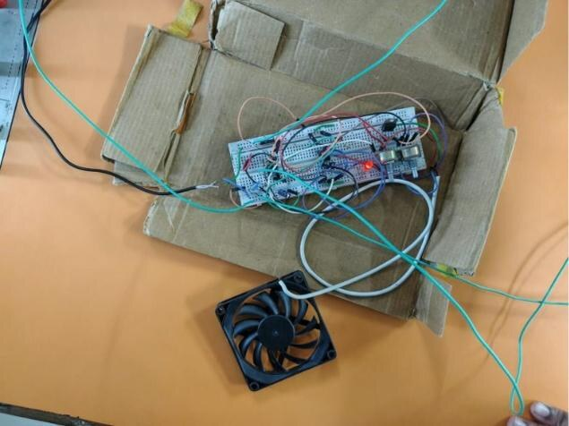
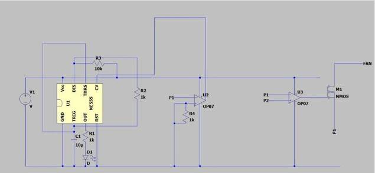
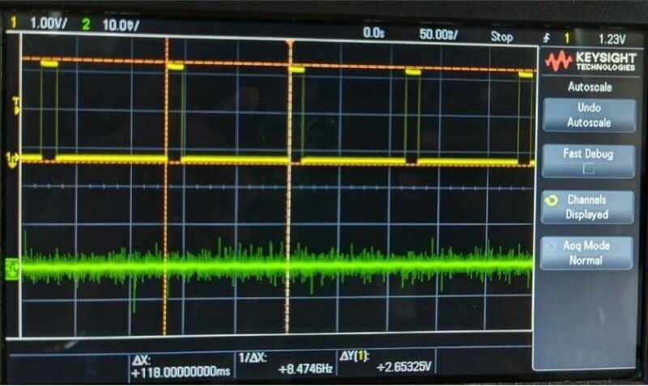
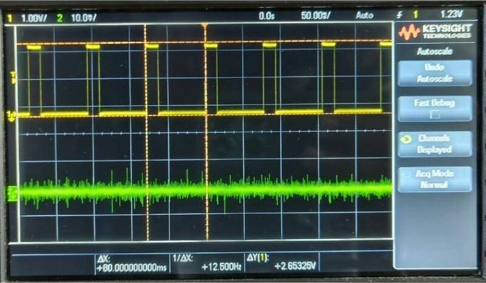
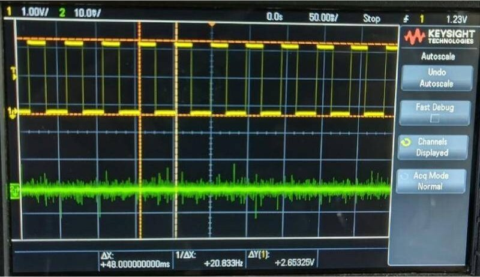
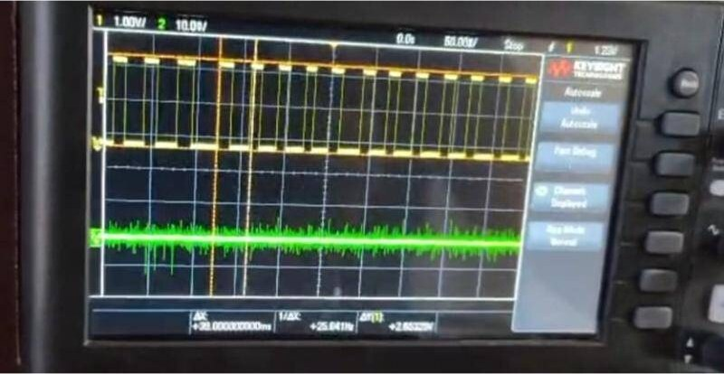
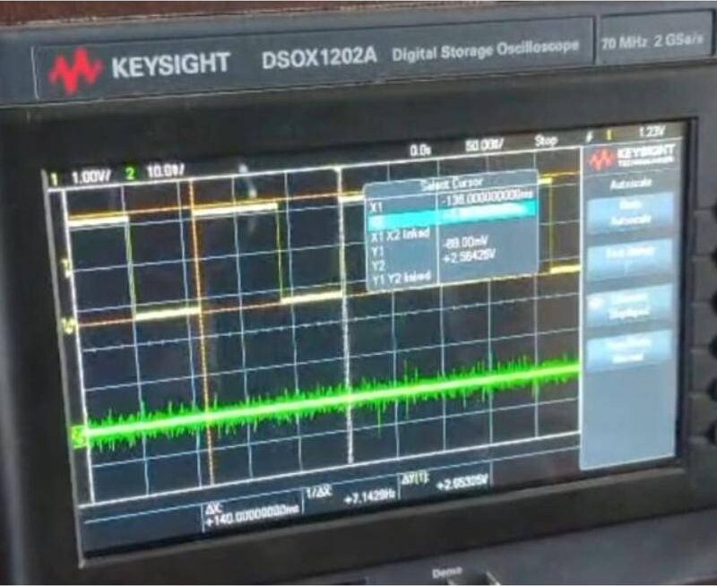

# Temperature-Controlled Clock Circuit (NE555 + Op-Amps)

An analog version of what a CPU does when it overheats. The clock speeds up under load. When the circuit detects too much stress, it switches on a cooling fan and throttles the clock back down. There is no microcontroller and no code.

This was a team project for Analog Electronics (BAECE203) at VIT Chennai, guided by Dr. Sangeetha R G.

## How it works
- **Clock:** an **NE555** timer generates the clock signal. A red LED blinks with every pulse.
- **Speed control:** an **op-amp** drives the 555's control-voltage pin (pin 5). This shifts its thresholds and changes the clock frequency.
- **Fan switch:** a second op-amp works as a **threshold detector**. When the input crosses the set-point, it switches an **NMOS** that turns on a 9 V fan.
- **Throttling:** a **feedback path** pulls the clock frequency back down to a safe range.

## Results
Measured on a Keysight DSOX1202A oscilloscope, with the period read using cursors.

| Setting | Frequency (period) | Scope capture |
|---|---|---|
| Low input | 8.47 Hz (118 ms) |  |
| Normal operating point (designed for 12.0 Hz, within 4%) | 12.5 Hz (80 ms) |  |
| Input pushed higher ("overclocked") | 20.8 Hz (48 ms) |  |
| Maximum, right at the threshold | 25.6 Hz (39 ms) |  |
| Threshold crossed: fan on, clock throttled back | 7.14 Hz (140 ms) |  |

- **Range:** the clock covers **7.1 Hz to 25.6 Hz**, set entirely by the voltage on one pin.
- **Modelling:** a Python model of the 555's charge/discharge cycle works backwards from each scope reading to the actual control voltage.

## Next improvements
- **Hysteresis,** so the fan doesn't chatter near the threshold.
- **PWM fan speed control** instead of on/off.
- **A real temperature sensor** in place of the potentiometer.
- **A PCB** instead of the breadboard.

## Team
Bharathwaaj Subramanian · Kiran Kumar Sundararaman · Mohit Chandravarman
